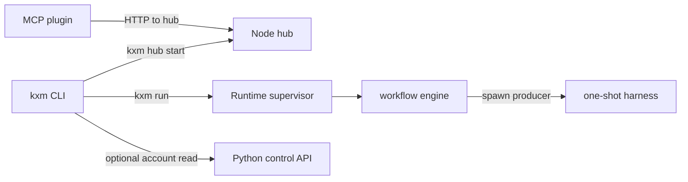

# Architecture overview

KXM on this checkout is local-first. The operator entry is the `kxm` CLI (`plugins/kxm/src/cli.ts`, launched through `scripts/kxm.mjs`). Reviewed configuration lives in Git under `.kxm/`.

## Hub

The hub is one Node.js HTTP and server-sent-events process. `scripts/kxm-hub.mjs` loads `plugins/kxm/dist/server.js`. `createHub` defaults the listener to `127.0.0.1` and port `7331` (`plugins/kxm/src/hub.ts`, `DEFAULT_PORT` in `plugins/kxm/src/protocol.ts`). State is SQLite at `.kxm/state/kxm.db`. The hub authenticates agents, stores messages, runs signed webhook workflows, keeps the journal and context, and accepts Runtime sync events. It does not run a model.

## Harnesses

A harness is the CLI that runs a model. Native ids are `claude`, `codex`, `grok`, `agy`, `kimi`, and `deepseek`. Pi is the long-lived worker and the host for allowlisted aggregators such as `openrouter/…`. `grok` and `agy` are one-shot CLIs. Dispatch spawns them from the producer in `plugins/kxm/src/oneshot-producer.ts`. Which harness a step uses comes from the selected `.kxm/models/<route>.yaml`, not from the agent file. The routing rules and the current rosters are on [Harness routing and rosters](../decisions/harness-routing.md).

## MCP plugin

`plugins/kxm` is the Claude Code plugin and the source of the Pi extension. The MCP server (`plugins/kxm/src/mcp-server.ts`) uses stdio. It has no TCP listener. It calls the hub at `KXM_SERVER_URL` or `http://127.0.0.1:7331`. The plugin authenticates as one project agent. On the hub machine it uses that project's saved token and does not use the admin token. Peer, workflow, and context tools are the `kxm_*` surface documented in `plugins/kxm/README.md`.

## Runtime engine

The accepted architecture contract says one local Runtime owns execution and the hub does not execute agents (`docs/contracts/architecture.md`). Plans call that accepted target vNext (`plans/research-a2a-cross-host.md`). The implementation that appends run, step, assignment, attempt, and effect events is `plugins/kxm/src/engine.ts` (`docs/contracts/README.md`).

`kxm run` posts `POST /v1/runs` to the Runtime supervisor (`plugins/kxm/src/runtime-supervisor.ts`). The supervisor listens on `127.0.0.1` and an ephemeral port unless one is requested. Drive then posts `POST /v1/runs/<runId>/drive`. Around a live spawn the engine fingerprints the checkout, invokes the one-shot producer, and fingerprints again. A write step that does not change the tree cannot stay `passed`. A read-only step that changes the tree cannot stay `passed` (`docs/architecture/agent-path.md`).

## Python control API

`python/kxm-control` is an additive FastAPI control API for central registration and bounded tenant artifacts. It does not replace the Node hub, Runtime, CLI, or their SQLite stores (`docs/architecture/platform.md`). Studio can relay `GET /api/control/account` when `KXM_CONTROL_URL` is set.

## What is not authority

Git is the authority for executable project behavior. The hub's compiled wiki and this authored tree are notes. Memory and learned content cannot grant tools, secrets, approvals, or policy (`docs/contracts/README.md`).
