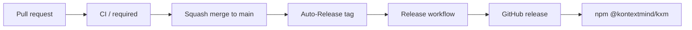

# Release flow

KXM releases a patch for every merged pull request. Nobody bumps versions by hand. The repository version in `package.json` stays at its base value. The release job stamps the tag version in the runner workspace only (`docs/contributing/ci-and-release.md`).

## Squash auto-merge and CI / required

Pull-request CI aggregates into the check named `CI / required` (job `required` in `.github/workflows/ci.yml`). It fails when a lane fails or is cancelled, and it passes when a lane was skipped on purpose. The contributing guide says to add that check to the `protect-main` ruleset. Skipped matrix legs are not required names, so they do not block auto-merge by themselves. The workflow files do not edit that ruleset (`docs/contributing/ci-and-release.md`).

`kxm land` enables auto-merge with `mergeMethod: SQUASH` (`docs/reference/cli-reference.md`). Auto-Release does not choose the merge method. It tags `github.event.pull_request.merge_commit_sha` after GitHub reports the pull request merged.

## Auto-Release

`.github/workflows/auto-release.yml` runs when a pull request to `main` is closed and merged. It finds the newest `vX.Y.Z` tag, adds one to the patch, annotated-tags the merge commit as `kxm-release[bot]`, and pushes the tag. A tag push made with `GITHUB_TOKEN` does not start another workflow, so the same job dispatches `.github/workflows/release.yml` with that tag.

Auto-Release skips the merge when the pull request has the `no-release` label, or when its head branch starts with `chore/release-`. If the tag already exists and points at a different commit, the job exits 1.

Auto-Release only increments the patch number. For a minor or major release, push a `vX.Y.0` tag yourself. `release.yml` also runs on `v*` tag pushes.

## GitHub release

`release.yml` checks out the tag and takes `scripts/kxm-bump-version.mjs` and `scripts/kxm-release-github.mjs` from `main`. It runs `npm run check:generated`, stamps the version, runs `npm run validate:ci`, and packs `kxm-<version>.tgz`. The step summary records the tarball sha256.

`scripts/kxm-release-github.mjs` creates a draft GitHub release, uploads the tarball, and checks the digest GitHub reports against the local one. The workflow then publishes the draft. A log line that the GitHub release is public is not an npm publish.

## npm

The `publish-npm` job runs in the protected `npm-publish` environment. It skips a version already on npm. Otherwise `scripts/kxm-publish-npm.mjs` confirms the GitHub release is published, downloads the asset, verifies its sha256 against the release digest, and runs `npm publish` on that exact file. The package name is `@kontextmind/kxm`. The job then polls `npm view @kontextmind/kxm@<version> version` for up to 20 minutes (`KXM_NPM_VISIBLE_WAIT_MS=0` skips the wait) and reports success only after the registry shows that version.

Every step is idempotent. Rerunning Release for a tag that is already published or already on npm reports it and changes nothing.

## Changelog

User-visible changes go in `CHANGELOG.md` under `## Unreleased` in the same pull request. No release step moves those entries into a dated section.
