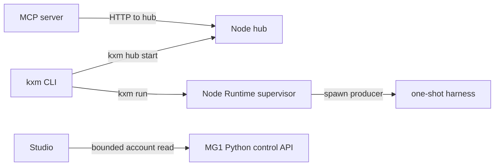

# Platform

Read from `plugins/kxm/src/cli.ts`, `plugins/kxm/src/runtime-supervisor.ts`,
`scripts/kxm-hub.mjs`, `plugins/kxm/src/hub.ts`, `plugins/kxm/src/mcp-server.ts`,
`plugins/kxm/src/oneshot-producer.ts`, and
`python/kxm-control/src/kxm_control/api.py`.

KXM on this checkout is local-first. The `kxm` CLI is the operator entry
(`plugins/kxm/src/cli.ts`, launched through `scripts/kxm.mjs`). The hub is an
HTTP server started by `scripts/kxm-hub.mjs`, which loads
`plugins/kxm/dist/server.js`. `createHub` defaults the listener to
`127.0.0.1` and port `7331` (`plugins/kxm/src/hub.ts`, `DEFAULT_PORT` in
`plugins/kxm/src/protocol.ts`). The Runtime supervisor
(`plugins/kxm/src/runtime-supervisor.ts`) listens on `127.0.0.1`. Its port
defaults to `0`, so the kernel picks an ephemeral port unless a port is
requested. The MCP server (`plugins/kxm/src/mcp-server.ts`) uses
`StdioServerTransport`. It has no TCP listener. It calls the hub at
`KXM_SERVER_URL` or `http://127.0.0.1:7331`. One-shot harness calls are
spawned by the producer registered in `plugins/kxm/src/oneshot-producer.ts`.
That child process is not a listener.

The checked-in MG1 Python control API is additive. It owns central registration
and bounded tenant artifacts through the fixed `kxmd` account. Only an owner
or admin membership can rename a tenant. Removing the registration schema
leaves source state in place, and later registry routes return
`registration_unavailable` until the schema is installed again. The API does
not install or change host or guest software. It does not replace the Node
hub, Runtime, CLI, or their SQLite stores. Studio can relay
`GET /api/control/account` to this service when `KXM_CONTROL_URL` is configured.

## Listeners

| Route | Listener |
| --- | --- |
| Hub HTTP | `127.0.0.1:7331` unless host or port is overridden |
| Supervisor HTTP | `127.0.0.1` and an ephemeral port when the requested port is `0` |
| MCP | stdio, no TCP port |
| CLI and one-shot harness | no listener |
| Studio, when served | `127.0.0.1:4242` from `createStudioServer` in `plugins/kxm/src/studio-layout.ts`; its optional control relay targets `KXM_CONTROL_URL` |
| Python control API | ASGI listener selected by deployment; the package declares no host or port default |
| Antigravity OAuth callback | loopback port `51121` only during login (`plugins/kxm/src/providers/antigravity/auth/oauth.ts`) |

## Related

- [Surfaces](inventory.md)
- [Agent path](agent-path.md)
